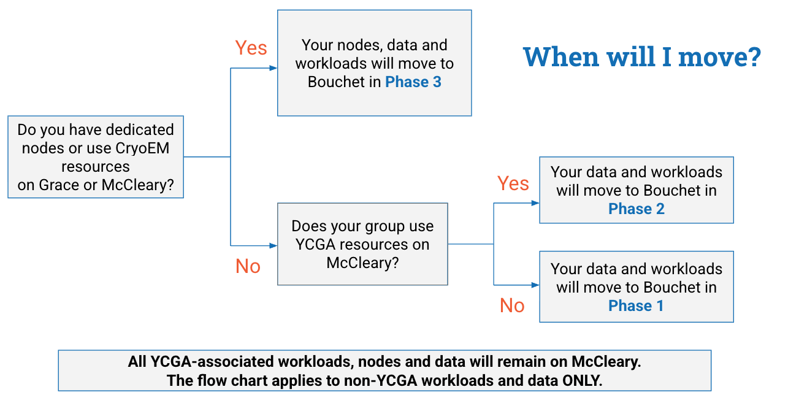

# Grace and McCleary Decommission

## Data Center Migration

The YCRC is in the process of transitioning from the Yale West Campus Data Center to the [MGHPCC data center](https://news.yale.edu/2025/02/26/yale-grows-capacity-high-performance-computing-ai-related-research). The [Bouchet](bouchet.md) cluster, Yale's first cluster hosted at MGHPCC, is the successor to both Grace and McCleary, with HPC infrastructure refreshes and growth deployed at MGHPCC going forward. In 2026, we are decommissioning Grace and McCleary and all non-YCGA data and workloads will be moved to Bouchet.

## Phased Decommission & Migration

During this phased migration, we will be fully decommissioning Grace as a standalone cluster and the McCleary cluster will be downsized to support exclusively YCGA-affiliated workloads. Newer nodes from Grace and McCleary and some of the attached storage will be moved to MGHPCC and added to Bouchet as additional capacity. The migration will happen in three phases, described below.

- [Phase 1](#phase-1) (**Complete**): Migration of workloads and data from research groups who do not use dedicated compute nodes, CryoEM resources or YCGA resources.

- Phase 2 (late 2026, early 2027): Migration of non-YCGA workloads and non-YCGA data from YCGA-affiliated research groups from McCleary. YCGA data and workloads will remain on McCleary for the remaining lifetime of the YCGA-owned hardware.

- Phase 3 (late 2026, early 2027): Migration of newer commons nodes from Grace and McCleary to Bouchet. Migration of newer dedicated nodes along with their associated research groups and data. Grace will be shut down. McCleary will remain as a YCGA-only cluster for the remaining lifetime of YCGA-owned hardware (at least late 2027).

{: .cluster-diagram}

If you are in Phase 2 or 3, more detailed information will be provided later this year when the hardware migration dates are finalized.

## Phase 1

Research groups who do not use dedicated compute nodes or YCGA resources were moved off of Grace and McCleary in Phase 1.
As of June 1st, users in Phase 1 no longer have access to Grace and McCleary.

## Groups that use YCGA resources

YCGA users, whether or not you use additional dedicated nodes, will retain access to McCleary for the rest of its lifetime for YCGA-related workloads (likely another couple years). This winter we will reach out to YCGA users about moving non-YCGA data and workflows to Bouchet, but there is no action required at this time.

When you do move your data, you will be responsible for identifying the non-YCGA data you would like to keep from your home, project, and scratch and transferring it either to non-HPC storage or to a Bouchet account but we will be available to assist with that process.

## Groups that use dedicated partitions

All non-YCGA hardware will either be moved to Bouchet or decommissioned, depending on age. All dedicated partitions on Grace and McCleary (other than YCGA) will be decommissioned during the data center migration this winter. Only nodes still under warranty as of January 1st, 2027 will be deployed into dedicated partitions at MGHPCC onto the Bouchet cluster. We have contacted each partition’s PI to confirm the future status of their dedicated partitions.

**Non-YCGA users who use dedicated nodes** will lose access to Grace, which will be shut down permanently, and/or McCleary. Later this fall we will reach out about moving data and workflows to Bouchet but there is nothing to do at this time.

## What about My Existing Data on Grace or McCleary?

**All (non-YCGA) data on Grace and McCleary (that you want to keep) will need to be transferred off the clusters.** You are responsible for identifying the data you would like to keep from your home, project, and scratch and transferring it either to non-HPC storage or to a Bouchet account. 

!!! warning "NIH Controlled Access Data"

	If you have any data on Grace or McCleary that is now covered by the [NIH Controlled Access Data policies](https://sharing.nih.gov/sites/default/files/flmngr/NIH-Security-BPs-for-Users-of-Controlled-Access-Data.pdf), this data cannot be moved to Bouchet but instead must be moved to the [Hopper](hopper.md) HPC cluster. [Submit this form to request Hopper access](https://research.computing.yale.edu/secure-project-request).

We encourage you to use the `getquota` utility on Grace and/or McCleary to examine the data usage by your group and specific group members. We recommend using [Globus](/data/globus/) to migrate individual data (i.e. home, project, scratch) to Bouchet as it is the fastest and most robust method of transferring data between the clusters. 

If there are members of your group who are no longer active and their directories contain data you would like to retain, please [reach out to us](/#get-help) to change the ownership of those files to an active group member so they can transfer the data. When transferring to Bouchet we recommend uploading the files to either the "shared" directory in project or in the directory of an active group member (rather than perpetuating the inactive group member's directories on Bouchet).

If you have current (not expired) paid storage allocations on either the Palmer or Gibbs storage system, an allocation of the same size is now available on Bouchet on the all-flash Roberts storage system for you to transfer data into (Phase 1 only for now.). If your storage allocation is expired, please [contact us](/#get-help) if you would like to purchase a storage allocation on Bouchet. 

If you would like assistance transferring your paid storage allocation or otherwise have questions or concerns about your data transfer, please [reach out to us](/#get-help) for assistance.

## Get Help

As always, our Research Support staff members are available to assist, including at our [twice-weekly virtual Office Hours](/#office-hours-via-zoom). Please [reach out](/#get-help) if you have any questions or concerns about what will be moved to Bouchet and when.

